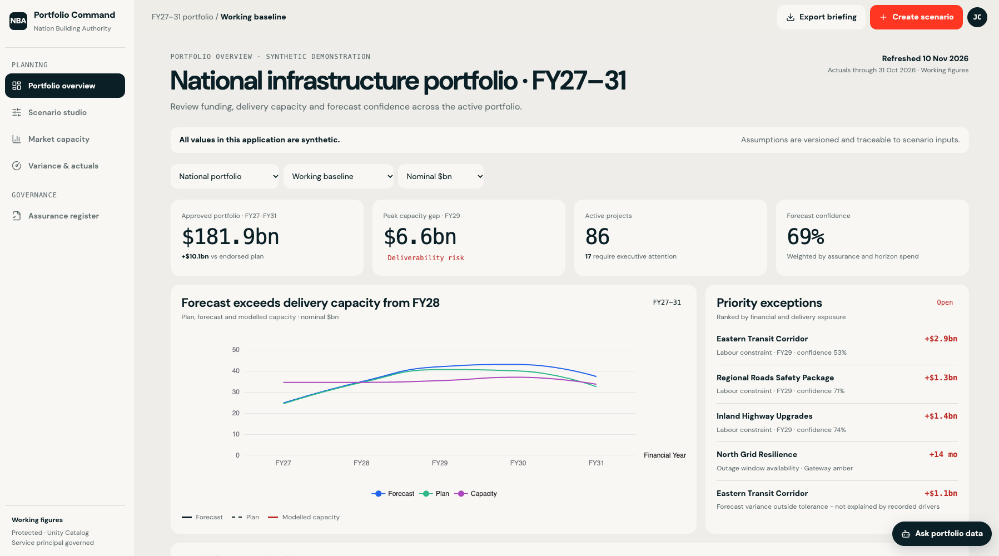

# Portfolio Command Centre

React and TypeScript Databricks App for the Nation Building Authority synthetic infrastructure portfolio. It combines typed SQL Warehouse analytics with the governed Portfolio Genie space.



## Local preview

Copy `.env.example` to `.env` (git-ignored) and fill in your own values: CLI profile, SQL warehouse,
Genie space, `budget_forecast` job ID and `PORTFOLIO_SCHEMA=<catalog>.<schema>`. Then:

```bash
npm run dev
```

Open `http://localhost:8000`. Reads and Genie run as your CLI identity, as they run as the signed-in
user in production.

## Queries

SQL lives in `config/query-templates/*.sql` and refers to tables as `{{schema}}.<table>`.
`npm run render:queries` (run automatically by `dev`, `start` and `typegen`) writes
`config/queries/`, which AppKit executes; that folder is git-ignored. In a deployed app the schema is
derived from the `scenario-definitions` table resource (`PORTFOLIO_TABLE` in `app.yaml`), so no
catalog or schema name is committed. After changing a template, run `npm run typegen` and commit
`shared/appkit-types`; deployed builds use those committed types.

## Verify

```bash
npm run typegen
npm run typecheck
npm run lint
npm run build
```

## Deploy

The app is a resource of the use case bundle (`../../resources/budget_portfolio.app.yml`). Deploy from
the use case folder:

```bash
cd ../..
databricks bundle deploy --target dev --var catalog=<YOUR_CATALOG> --var warehouse_id=<YOUR_WAREHOUSE_ID> \
  --var genie_space_id=<YOUR_GENIE_SPACE_ID> --var genie_space_name="<YOUR_GENIE_SPACE_NAME>"
databricks apps logs nba-budget-portfolio --tail-lines 200
```

Application source is in `client/src` and the AppKit server entry point is `server/server.ts`.
