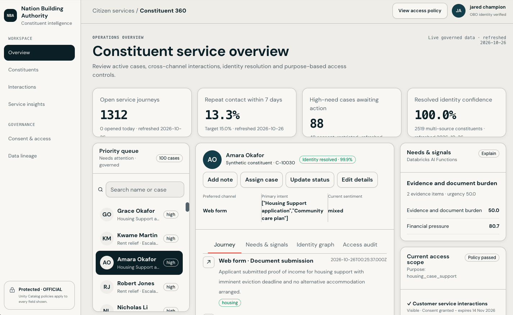

# Constituent 360 App

 

AppKit React workspace for governed constituent case work. Analytics and procedure calls run on behalf of the signed-in user so Unity Catalog row filters, masks, consent, and purpose-of-use controls apply.

## Install and preview

```bash
cd app/nba-constituent-360
npm ci
databricks apps run-local --profile au-pubsec
```

## Validate

```bash
npm run typegen
npm run typecheck
npm run lint
npm run lint:ast-grep
npm test
npm run build
databricks apps validate --profile au-pubsec
```

## Deploy and verify

```bash
databricks apps deploy --profile au-pubsec \
  --var warehouse_id=083bec41aa3ab495 \
  --var genie_space_id=<GENIE_AGENT_ID>
databricks apps get nba-constituent-360 --profile au-pubsec -o json
databricks apps logs nba-constituent-360 --profile au-pubsec --tail-lines 200
```

The deployed app requests only `sql` and `genie` user scopes. Initial launch permission is assigned only to `jared.champion@databricks.com`.
