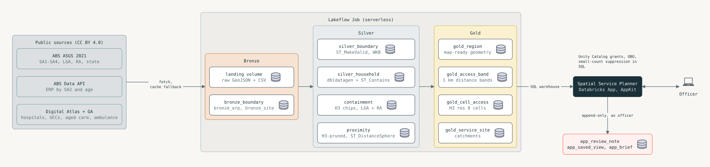

# Geospatial Analysis

| | |
| --- | --- |
| **Category** | Physical Security |
| **Selected function** | Geospatial Analysis |
| **Evidence anchor** | None public - pattern-based selection (see below) |
| **Target KPI** | Time to spatial insight (measure to instrument) |
| **Status** | **Built** - pipeline job and Spatial Service Planner app, deployed and verified end to end |

## Problem

Most government questions have a "where" in them: which households are beyond reasonable reach of
a service, which assets sit inside a hazard zone, how an incident propagates across a network.
Spatial data is large, awkwardly formatted, and usually sits in a specialist tool disconnected from
everything else, so these questions take days and the answers cannot be joined to anything.

## What this use case demonstrates

Spatial analysis as a first-class part of the lakehouse rather than a separate stack: indexed
spatial data, proximity and containment analysis at scale, and spatial aggregates that join
directly to non-spatial data - served to an officer-facing planning app under Unity Catalog.

The concrete question: **how far do Australians live from the essential services they rely on, and
where would a new site close the gap?** Four services, all from public national registers:

| Service | Sites | Default threshold | Source (CC BY 4.0) |
| --- | ---: | ---: | --- |
| Public hospitals | ~705 | 45 km | Declared Public Hospitals, Department of Health, Disability and Ageing |
| Medicare Urgent Care Clinics | ~137 | 30 km | Medicare Urgent Care Clinics, Department of Health, Disability and Ageing |
| Residential aged care | ~2,590 | 30 km | Australian Aged Care Services, Department of Health, Disability and Ageing |
| Ambulance stations | ~1,170 | 25 km | Emergency Management Facilities, Geoscience Australia |

Thresholds are planning defaults for the demo, not policy; the officer sets the threshold.

## Modelled on

Nothing publicly citable. Unlike the flagship, this selection rests on the architectural pattern
rather than on a published customer outcome, and it is worth strengthening if a citable reference
becomes available.

The pattern itself is well supported: Databricks SQL spatial functions and H3 indexing make
large-scale spatial joins tractable, and genuinely public Australian boundary data makes the
analysis realistic. Household-to-service distance is the canonical example because it is the
spatial question that most often has a policy consequence attached to it.

## Architecture



Source: [docs/architecture.reladraw](docs/architecture.reladraw).

| Step | Notebook | What it does |
| --- | --- | --- |
| 0 | `src/00_setup.py` | Schema, landing volume, and the officer write-back tables (`app_review_note`, `app_saved_view`, `app_brief`) - `CREATE IF NOT EXISTS`, so a re-run never discards officer work |
| 1 | `src/01_fetch_boundaries.py` | **Spatial ingest.** ABS ASGS 2021 boundaries (61,811 SA1s; SA2-SA4, LGA, Remoteness Area and state) fetched from the ABS ArcGIS services, landed as GeoJSON, conformed to WKB with `ST_GeomFromGeoJSON` / `ST_MakeValid` |
| 2 | `src/02_fetch_population.py` | ABS estimated resident population by SA2 and age (latest year, ABS Data API) - total and share aged 65+ |
| 3 | `src/03_fetch_services.py` | The four service layers, conformed, de-duplicated, state assigned by `ST_Contains` against ABS states, H3-indexed |
| 4 | `src/04_generate_households.py` | **The only synthetic data.** ~11 million households from ABS 2021 Census-shaped distributions (**dbldatagen**, seeded), placed inside real SA1s by rejection sampling with `ST_Contains`, in proportion to real ERP |
| 5 | `src/05_containment.py` | **Containment.** Point-in-polygon for every household against 547 LGAs via `h3_tessellateaswkb` chips (core chips need no geometry test); Remoteness Area per SA1 (the ABS builds RA from whole SA1s) |
| 6 | `src/06_proximity.py` | **Proximity.** Exact nearest site per household and service. Two-level H3 pruning with a provable bound cuts the work to ~0.3% of all pairs (≈158 million `ST_DistanceSphere` calls instead of ≈50 billion) |
| 7 | `src/07_gold_aggregates.py` | **Spatial aggregation and map-ready serving.** Regions with `ST_Simplify`-ed geometry, 1 km distance bands per region and per H3 cell, site catchments, pipeline metrics |

Shared definitions (sources, geographies, service types, distributions, constants) live in
`src/common.py`; no catalog, schema or volume name appears in code.

A full-scale run takes about 10 minutes on serverless. If a public source is unreachable, the
step reuses the last good copy in the landing volume and records `from_cache = true` in
`ref_source`, which the app surfaces.

## The app: Spatial Service Planner

`app/nba-spatial-planner` (AppKit: Node + React), built from the design handoff in
[design/](design/) - see [design/DESIGN-HANDOFF.md](design/DESIGN-HANDOFF.md) for what was kept,
changed and added.

- **Analysis** - choose service, area (state or national), geography (SA4, SA3, SA2, LGA,
  Remoteness Area, state) and a threshold; Run analysis applies the draft. The map shows regions
  or an H3 hexagon grid (resolution follows zoom), service sites with threshold radius rings, and a
  region search. Decision signals give people beyond the threshold, regions beyond, priority
  cohorts (65+, households without a car) and a remoteness breakdown.
- **New-site scenario** - click up to five proposed sites onto the map to see how many people would
  be brought within the threshold, and where.
- **Evidence queue** - every region with its access class, median distance, people beyond and
  evidence status; officers record append-only review notes; CSV export keeps suppression.
- **Decision briefs** - record the policy question, access basis and audience; the figures are
  snapshotted; a second step signs the brief off; print or save as PDF. Briefs cannot be prepared
  with suppression off.
- **Data pipeline** and **Assurance** tabs show real run metrics, source provenance and the
  publication checklist.
- Every view is a shareable URL; saved views are shared across officers.

Every query (`config/queries/*.obo.sql`) and every write runs **on behalf of the signed-in
officer**, so Unity Catalog grants apply per user and records carry `current_user()`, never a
client-supplied name. Small-count suppression (default: under 10 people) is applied in SQL, so a
suppressed value never reaches the browser.

## Data

| Data | Real or synthetic | How |
| --- | --- | --- |
| Statistical boundaries (ABS ASGS 2021) | Real, CC BY 4.0 | Fetched at run time, never committed |
| Estimated resident population by SA2 and age | Real, CC BY 4.0 | Fetched at run time |
| Service locations (four layers) | Real, CC BY 4.0 | Fetched at run time |
| Households: location, size, tenure, dwelling type, 65+ residents, vehicle access | **Synthetic** | dbldatagen + seeded hashes, seed `42`; distributed in proportion to real ERP |

No record describes a real household. Vehicle access is modelled from remoteness, not measured.
Distances are straight-line, not road travel time.

## Deploy and run

Everything environment-specific is a bundle variable. Create the git-ignored overrides once:

```bash
# usecase/geospatial_analysis/.databricks/bundle/dev/variable-overrides.json
{ "catalog": "<YOUR_CATALOG>", "warehouse_id": "<YOUR_WAREHOUSE_ID>" }

# usecase/geospatial_analysis/app/nba-spatial-planner/.databricks/bundle/default/variable-overrides.json
{ "catalog": "<YOUR_CATALOG>", "schema": "geospatial_analysis_<your_short_name>", "sql_warehouse_id": "<YOUR_WAREHOUSE_ID>" }
```

Then:

```bash
cd usecase/geospatial_analysis

# 1. Pipeline: deploy and run (about 10 minutes; --var household_scale=0.05 for a quick dev run)
databricks bundle validate --target dev --profile <PROFILE>
databricks bundle deploy   --target dev --profile <PROFILE>
databricks bundle run geospatial_analysis_pipeline --target dev --profile <PROFILE>

# 2. App: validate, deploy, check
cd app/nba-spatial-planner
databricks apps validate --profile <PROFILE>
databricks bundle deploy --profile <PROFILE>
databricks apps get nba-spatial-planner --profile <PROFILE> -o json   # app_status.state: RUNNING, url
```

Officers using the app need `USE CATALOG` / `USE SCHEMA`, `SELECT` on the `gold_*`, `ref_source`
and `app_*` tables, and `MODIFY` on the three `app_*` tables. The app's service principal needs
none of them: everything runs as the user.

### Local development

```bash
cd usecase/geospatial_analysis/app/nba-spatial-planner
cp .env.example .env            # set profile, warehouse, catalog, schema
npm install
npm run dev                     # http://localhost:8000
npm test                        # unit tests (contracts, settings, projection, rules)
npm run test:e2e                # Playwright smoke test of the demo path (read-only)
```

Run `npm run typegen` after changing a query. The committed `shared/appkit-types` are used by the
Apps build, whose service principal deliberately cannot read the OBO-only tables
(`scripts/typegen.mjs`).

## Assurance notes

Location data is identifying even when nothing else in the record is: a sufficiently precise
home-location trace identifies a person regardless of how the other columns are masked. Spatial
aggregation is therefore a privacy control as much as an analytical step:

- Household rows stay in silver; the app reads only aggregates.
- Small counts are suppressed in SQL at a configurable disclosure threshold (`SUPPRESSION_MIN_COUNT`);
  H3 cells below it are not returned at all.
- Briefs record purpose, access basis and audience, and need sign-off before circulation.

Relevant: the
[Protective Security Policy Framework](https://www.protectivesecurity.gov.au/about/structure-protective-security-policy-framework).

## Not built yet

- Road-network travel time (out of scope by design; distances are straight-line).
- Service capacity: catchments are computed, but nothing models whether a site can absorb them.
- Sign-off by a second officer is recorded but not enforced (one officer can prepare and sign off).
- Population projections: the analysis uses the latest ERP, not future population.
