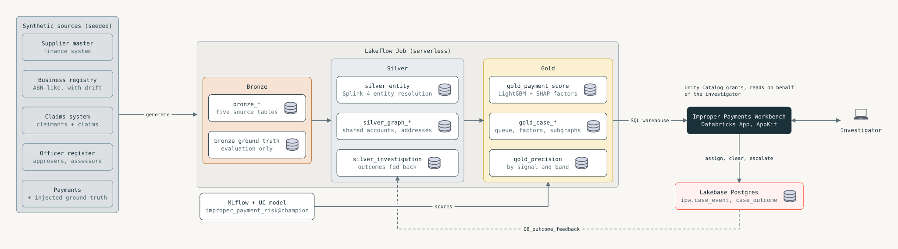

# Improper Payments Detection

| | |
| --- | --- |
| **Category** | Fraud Prevention |
| **Selected function** | Fraud Detection (improper payments) |
| **Evidence anchor** | [A smarter state: AI outlook in the public sector](https://www.databricks.com/sites/default/files/2025-02/public-sector-report-jan-30.pdf) |
| **Target KPI** | Improper payments identified and recovered |
| **Status** | **Built** - synthetic pipeline, scoring model, investigator workbench app, outcome feedback loop |
| **Build priority** | 3 |



## Problem

Payments go out at volume and at speed, and the signals that a payment was improper are rarely in
the payment record itself. They are in the relationships between entities: the same bank account
under two supplier names, a claimant and an assessor sharing an address, a vendor created days
before its first invoice. Those relationships are invisible to row-by-row rule checking, so
improper payments are usually found long after the money has left.

## What this use case demonstrates

Resolving entities across disconnected sources to expose hidden relationships, building a
relationship graph, scoring payments for improper-payment risk, and triaging to investigators with
an explanation they can act on, then measuring how many flags survive investigation.

## Modelled on

Databricks' [A smarter state: AI outlook in the public sector](https://www.databricks.com/sites/default/files/2025-02/public-sector-report-jan-30.pdf)
reports the US Department of Defense using AI-driven tools to process more than 10 million records
and identify over US$12.7 billion in true improper payments since 2020.

Reference implementations: the
[Entity Resolution for Public Sector accelerator](https://community.databricks.com/t5/announcements/solution-accelerator-series-entity-resolution-for-public-sector/m-p/169611/highlight/true)
and the [Smart Claims accelerator](https://www.databricks.com/solutions/accelerators/smart-claims-for-insurance),
whose stated goals are lowering cost, reducing fraud, and accelerating settlement. Databricks'
[Public Sector Solutions](https://www.databricks.com/solutions/industries/public-sector) page
covers the surrounding fraud, waste and abuse detection pattern.

Note on the "true improper payments" phrasing in the DoD figure: it matters. The useful measure is
not how many payments a model flagged but how many flags survived investigation. That is why the
workbench records every investigation outcome and the Precision view reports from outcomes, not
from flag volume.

## What is built

| Function | Where | What it does |
| --- | --- | --- |
| Payment and claim ingest | `src/01_generate_sources.py` | Seeded synthetic data from four disconnected systems (supplier master, business registry, claims, officer register) plus payments, with improper patterns and benign look-alikes injected and labelled in `bronze_ground_truth` |
| Entity resolution | `src/02_entity_resolution.py`, `src/er_splink.py`, `src/er_rules.py` | Splink 4 probabilistic linkage over ABN, name, address and identity; union-find clusters with stable ids; deterministic fallback |
| Relationship graph | `src/03_graph.py`, `src/graph.py` | Entities linked through bank accounts, addresses, phones, emails, directors and approving officers; connected components and two-hop links |
| Risk scoring | `src/04_features.py`, `src/05_train_model.py`, `src/06_score_and_cases.py` | Rule signals plus a LightGBM model tracked in MLflow and registered in Unity Catalog (`improper_payment_risk@champion`); calibrated 0-100 score; SHAP and rule factors retained |
| Investigator triage | `src/06_score_and_cases.py`, `app/nba-payments-workbench` | Cases per resolved supplier or claimant cluster, each with ranked factors, a linked-entity subgraph and its payments; a Databricks App to assign, clear or escalate |
| Outcome feedback | `app/.../server/state.ts`, `src/08_outcome_feedback.py`, `src/07_gold_reporting.py` | Decisions are recorded in Lakebase Postgres, read back into Unity Catalog, and reported as precision by signal and risk band |

Tables, injected patterns and results: [docs/pipeline-notes.md](docs/pipeline-notes.md). App
design and its deltas from the design export: [design/DESIGN-HANDOFF.md](design/DESIGN-HANDOFF.md).

## Data

Wholly synthetic and seeded (`seed`, default 42), with known improper-payment patterns and benign
look-alikes deliberately injected so that detection can be measured against ground truth. No real
agencies, people or businesses. Synthetic detection rates say nothing about real-world
performance.

## Deploy

Supply environment values with `--var` or the git-ignored
`.databricks/bundle/<target>/variable-overrides.json`; nothing environment-specific is committed.

```bash
# 1. Pipeline, job and Lakebase project
databricks bundle validate --target dev --var catalog=<YOUR_CATALOG> --var warehouse_id=<WAREHOUSE_ID>
databricks bundle deploy   --target dev --var catalog=<YOUR_CATALOG> --var warehouse_id=<WAREHOUSE_ID>
databricks bundle run improper_payments_pipeline --target dev

# 2. The app (its own bundle). Find the branch and database with
#    databricks postgres list-branches projects/<lakebase-project-id>
#    databricks postgres list-databases <branch-name>
cd app/nba-payments-workbench
databricks bundle deploy --var catalog=<YOUR_CATALOG> --var schema=<SCHEMA> \
  --var sql_warehouse_id=<WAREHOUSE_ID> --var postgres_branch=<BRANCH> --var postgres_database=<DATABASE>
databricks bundle run app

# 3. After investigators record outcomes, feed them back without retraining
cd ../.. && databricks bundle run improper_payments_feedback --target dev
```

In `dev` the schema is `improper_payments_detection_<your-short-name>` and the Lakebase project is
namespaced per developer. Deploy the app before running it locally, so its service principal
creates and owns the `ipw` schema in Lakebase.

## Verify

```bash
python3 -m pytest tests/                          # entity resolution and graph units
cd app/nba-payments-workbench
npm run typecheck && npm run lint && npm test     # contracts, queue logic, graph layout
npm run dev                                       # http://localhost:8000 (uses .env, see .env.example)
npm run test:e2e                                  # Playwright smoke path; BASE_URL for a deployed app
```

## Assurance notes

Fraud risk scores are among the most consequential outputs in this catalogue: a false positive
puts a person or business under investigation. In the workbench, scores are labelled as
indicators, not findings, on every surface; every outcome needs a reason and notes, is recorded
against the investigator's name with the score they saw, and is final. Reads run on behalf of the
signed-in investigator, so Unity Catalog grants decide what each person can see, and every write
is checked against Unity Catalog as that person first.

What a real deployment would still need: an assurance assessment and transparency statement under
the [DTA AI assurance framework](https://www.dta.gov.au/articles/dta-pilots-new-ai-assurance-framework),
because a score influences a decision about an identifiable person; tight Unity Catalog controls
and full audit over the graph and scores; and a privacy assessment, because entity resolution
links records that were previously separate and so creates an exposure that does not exist in the
source systems. Nothing here blocks or recovers a payment automatically.
