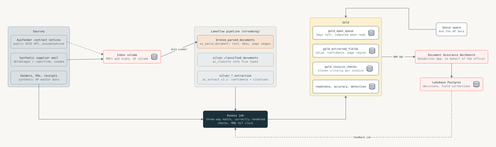

# Intelligent Document Processing

| | |
| --- | --- |
| **Category** | Back Office Automation |
| **Selected function** | Intelligent Document Processing |
| **Evidence anchor** | [PDFs to Production](https://www.databricks.com/blog/pdfs-production-announcing-state-art-document-intelligence-databricks) |
| **Target KPI** | Document processing cost (measure to instrument); invoices paid within the RMG 417 term |
| **Status** | **Built** - document pipeline on public AusTender contracts, Document Assurance Workbench app, Genie space, decision feedback loop |
| **Build priority** | 2 |



## Problem

Government runs on documents, and accounts payable is where that costs money by the day. Every
supplier invoice is checked by hand against its purchase order and the tax-invoice rules, and
the information in it is re-keyed. Under the
[Supplier Pay On-Time or Pay Interest Policy (RMG 417)](https://www.finance.gov.au/publications/resource-management-guides/supplier-pay-time-or-pay-interest-policy-rmg-417),
the payment clock starts the day after **both** delivery is acknowledged **and** a *correctly
rendered* invoice is received. That is whether or not anyone in AP has looked at it yet.

The maximum term is currently 20 calendar days, or 5 for Peppol e-invoices. From **1 January
2027** it becomes
[10 business days for all invoice types](https://www.finance.gov.au/government/procurement/procurement-policy-notes/updated-commonwealth-supplier-payment-terms).
Late payment accrues interest at the
[ATO general interest charge](https://www.ato.gov.au/tax-rates-and-codes/general-interest-charge-rates)
rate, and it is payable once it exceeds A$100.

## What this use case demonstrates

It turns a mixed supplier inbox into governed, structured records with evidence:

- Parse every document with `ai_parse_document`.
- Classify each one with `ai_classify`.
- Extract typed fields with `ai_extract` v2.1, which returns a confidence score and a citation
  to a region on the page for each field.
- Match each invoice three ways: invoice, purchase order and goods receipt.
- Run the correctly rendered checks.
- Compute the payment clock.

Clean invoices go straight through. Only uncertain or non-compliant ones reach a person, and that
person sees where every value sits on the page.

## Modelled on

[PDFs to Production: announcing state-of-the-art document intelligence on Databricks](https://www.databricks.com/blog/pdfs-production-announcing-state-art-document-intelligence-databricks)
(11 November 2025) introduces `ai_parse_document`. It parses PDFs in SQL and emits layout, tables,
bounding boxes and page images into Unity Catalog. Databricks reports it delivering competitive
quality at 3-5x lower cost than competing offerings. That figure is Databricks' own claim; nothing
here reproduces it.

The [intelligent document processing guide](https://docs.databricks.com/aws/en/agents/agent-bricks/intelligent-document-processing)
sets out the reusable parsed bronze layer this use case builds. The "correctly rendered" criteria
come from RMG 417, the
[Commonwealth Contracting Suite](https://www.finance.gov.au/government/procurement/commonwealth-contracting-suite-ccs)
model definition and the
[ATO tax invoice rules](https://www.ato.gov.au/businesses-and-organisations/gst-excise-and-indirect-taxes/gst/tax-invoices).

## What is built

| Function | Where | What it does |
| --- | --- | --- |
| Public contracts | `src/01_fetch_contracts.py` | Fetches recent Australian Government contract notices from the [AusTender OCDS API](https://github.com/austender/austender-ocds-api) at run time. Keeps the description, UNSPSC category, value, period and method. Discards supplier names and ids, notice ids and the procuring entity before anything is written. Falls back to synthetic notices (dbldatagen) if the API is unreachable, and records which source was used. |
| Synthetic inbox | `src/02_generate_corpus.py`, `src/corpus.py`, `src/render.py` | dbldatagen generates supplier attributes and document specs; `corpus.py` builds purchase orders within each contract value, invoices within each order, receipts, duplicates of real earlier invoices, statements, letters and quotes. reportlab renders five invoice layouts, and about 16% arrive as degraded scans. Twelve kinds of defect are injected and labelled in `bronze_ground_truth`. |
| Volume landing and parsed bronze | `src/pipeline/document_processing.py` | A Lakeflow Spark Declarative Pipeline. Auto Loader picks up new files in the inbox volume. `ai_parse_document` produces `bronze_parsed_documents` with page images, the generic layer other use cases can reuse. |
| Classification | same | `ai_classify` sorts tax invoices, adjustment notes, statements, correspondence and quotes. |
| Schema-driven extraction | same, schemas in `src/common.py` | `ai_extract` v2.1 runs a schema per document type, with `enableCitations` and `enableConfidenceScores`. |
| Confidence and checks | `src/03_assess.py`, `src/assess.py`, `src/rules.py` | Routing confidence combines the model's score with grounding (the value is found in its cited region, or elsewhere in the document at a discount) and type validity. A ledger in arrival order handles three-way matching, duplicates and remaining order value. Eleven correctly rendered checks run per invoice. The pay-by date is computed under both regimes, on an ACT business-day calendar. |
| Review queue and decisions | `app/nba-document-workbench` | Databricks App (AppKit, React) reading as the signed-in officer. Covers the clock-ordered queue, the review workspace with cited evidence on the rendered page, accept and return, intake, register, performance and decision log. Decisions and field corrections go to Lakebase Postgres. |
| Corpus Q&A | `src/04_genie_space.py` | A Genie space over the gold tables, embedded as "Ask the AP data". Extracted bank details are left out. |
| Feedback | `src/05_sync_decisions.py`, `idp_feedback` job | Copies decisions and corrections into Unity Catalog and rebuilds the accuracy and readiness measures. |
| Ingest | `idp_arrivals` job | Lands a batch of new mail and processes only those documents. The workbench's "Ingest documents" runs it. A paused weekday schedule keeps the queue fresh. |

## Results on the synthetic corpus

From the first build (600 documents, seed 42, contracts fetched live from AusTender on 27
November 2026). These describe this clean synthetic corpus only, and say nothing about real,
degraded or handwritten documents.

- **Classification:** `ai_classify` agreed with ground truth on all 600 documents.
- **Defect detection:** every injected supplier-side defect was caught by its check, either as an
  exception or held for review. 4 of 278 clean invoices would have been sent back wrongly.
- **Straight-through rate:** 52.4% of assessed invoices passed every check with confident fields.
- **Wrong and not held:** 10 extracted field values disagreed with ground truth but passed the
  confidence gate, out of about 6,800. This is the risk figure the Performance view leads with.
- **Typical misread:** the model merging a street number into the ABN ("83 792 749 072 122"). It
  is held, because the value fails type validity, and the officer corrects it on the page.
- **Run times:** the first pipeline run (parse, classify and extract 600 documents) took about 20
  minutes. A 12-document arrivals batch, end to end, took about 5 minutes.

Measures that need real operations are not claimed: processing cost, and real late-payment rates.
The readiness chart runs on *simulated* processing history and is labelled that way.

## Data

- **Public:** AusTender contract notices (substance only, pseudonymised at fetch time), and
  national and ACT public holidays from the open-source `holidays` package.
- **Synthetic and seeded:** suppliers, purchase orders, receipts, every document and the
  processing history. Supplier names are generated from word lists; any resemblance to a real
  business is coincidental. ABNs pass the check-digit test but are random.

No real document, supplier or person appears anywhere.

## Deploy

Supply environment values with `--var` or the git-ignored
`.databricks/bundle/<target>/variable-overrides.json`; nothing environment-specific is committed.

```bash
# 1. Pipeline, jobs, Lakeflow pipeline and Lakebase project
databricks bundle validate --target dev --var catalog=<YOUR_CATALOG> --var warehouse_id=<WAREHOUSE_ID>
databricks bundle deploy   --target dev --var catalog=<YOUR_CATALOG> --var warehouse_id=<WAREHOUSE_ID>
databricks bundle run idp_pipeline --target dev      # about 20 minutes the first time

# 2. The app (its own bundle). The Genie space id is in corpus_control (key genie_space_id); the
#    arrivals job id from `databricks jobs list`; Lakebase names from
#    databricks postgres list-branches projects/<lakebase-project-id>
#    databricks postgres list-databases <branch-name>
cd app/nba-document-workbench
databricks bundle deploy --var catalog=<YOUR_CATALOG> --var schema=<SCHEMA> --var sql_warehouse_id=<WAREHOUSE_ID> \
  --var genie_space_id=<GENIE_SPACE_ID> --var arrivals_job_id=<ARRIVALS_JOB_ID> \
  --var postgres_branch=<BRANCH> --var postgres_database=<DATABASE>
databricks bundle run app

# 3. After reviewers record decisions, rebuild the measures without parsing anything
cd ../.. && databricks bundle run idp_feedback --target dev
```

In `dev`, the schema is `intelligent_document_processing_<your-short-name>` and the Lakebase
project is namespaced per developer. To regenerate the corpus from scratch:

```bash
databricks bundle run idp_pipeline --target dev --params reset=true
databricks bundle run document_processing --target dev --full-refresh-all
```

Officers need `SELECT` on the gold and `ref_` tables and `READ VOLUME` on the document volume,
because the app reads on their behalf.

## Verify

```bash
python3 -m pytest tests/                          # rules, assessment ledger, corpus (35 tests)
cd app/nba-document-workbench
npm run typecheck && npm run lint && npm test     # decision rules, recheck, queue logic
npm run dev                                       # http://localhost:8000 (uses .env, see .env.example)
```

## Assurance notes

- **Classification.** Documents are the most likely place for unexpected personal or sensitive
  information. The inbox volume and the parsed bronze layer should be treated at the highest
  classification of anything in the corpus under the
  [Protective Security Policy Framework](https://www.protectivesecurity.gov.au/about/structure-protective-security-policy-framework).
  See also the PSPF
  [policy advisory on OFFICIAL information and generative AI](https://www.protectivesecurity.gov.au/news/policy-advisory-official-information-use-generative-artificial-intelligence).
- **Confidence is a routing control, not a quality claim.** The workbench never presents it as a
  probability.
- **A held field must be resolved before acceptance.** It has to be confirmed against the page or
  corrected; a malformed value can only be corrected.
- **Failed checks are explicit.** A failed check needs a written override to accept past it, and a
  return names the criterion it failed.
- **Bank details are never changed from correspondence.** A bank-detail-change letter is flagged as
  possible payment redirection, with an instruction to verify through the vendor master.
- **Reads and decisions are attributable.** Reads run on behalf of the signed-in officer, so Unity
  Catalog grants decide what each person sees, including page images. Every decision is recorded
  against that person with what the machine said at the time.
- **What a real deployment would still need:** an assurance assessment under the
  [DTA AI assurance framework](https://www.dta.gov.au/articles/dta-pilots-new-ai-assurance-framework),
  testing on real, degraded documents, and integration with the finance system. The workbench does
  not write back to it or approve payments.

## Not built yet

- Processing-cost instrumentation (AI function spend per document from system billing tables).
- Peppol e-invoice ingestion. The corpus marks the channel, but every document arrives as a PDF or
  a scan.
- Re-running the order-ledger checks (order match, remaining value, duplicates) after a reviewer
  corrects a purchase order number. Field-local checks re-run; ledger checks keep the pipeline's
  result until the next assessment.
